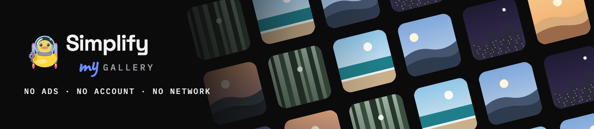
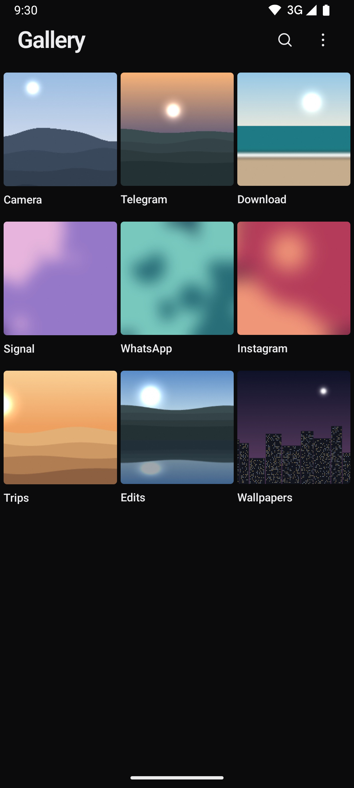
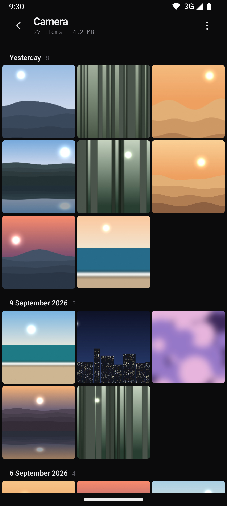
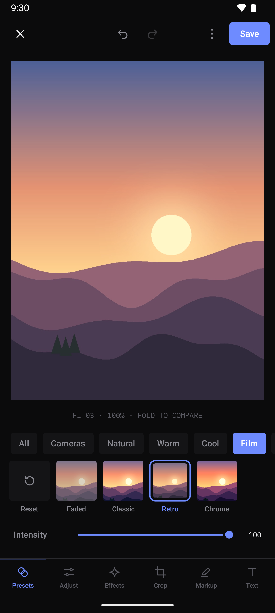
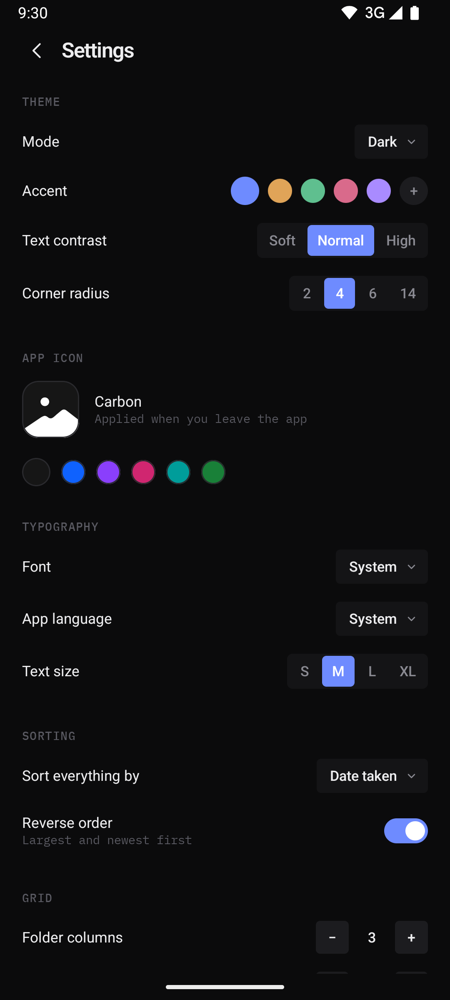

<p align="center">
  
</p>
<p align="center">
  <b>Your photos, by folder, on your phone only.</b><br>
  Free. No ads, no account, no analytics. No network permission at all.
</p>

<p align="center">
  <a href="https://play.google.com/store/apps/details?id=app.simplifymy.gallery">Google Play</a> ·
  <a href="https://simplifymy.app/">Website</a> ·
  <a href="https://github.com/simplify-apps/gallery/releases">Changelog</a>
</p>

<p align="center">
  
  
  
</p>

A gallery for Android that opens on your folders, the way they are on the phone, instead of a timeline someone sorted for you. Photos and videos are read straight from MediaStore and never leave the device: the app does not ask for internet access, so there is nothing to send and nowhere to send it. Around the media sits the same quiet interface as the other Simplify apps: a grid, a viewer and a menu that only holds what you use.

## ✦ What it does

| | |
| --- | --- |
| **Folders** | Every folder with photos or videos, its cover, item count and size. Pin the ones you open most, ignore the ones you never want to see. Optionally a Recent tile first, with everything newest first |
| **Media** | A grid per folder or across everything, grouped by day or month, sorted by date taken, modified, name, size or type, filtered to images or videos |
| **Viewer** | Pinch and double-tap zoom, swipe between items, swipe up for details with camera, exposure, size, dimensions and path, swipe down to close |
| **Video** | Built-in player with seeking, mute, playback speed from 0.25× to 2×, and autoplay of the next video in the folder |
| **Edit** | Crop, rotate, mirror, straighten and fix perspective. Light and colour sliders, tone curve, colour mix, split tone. Presets, retro camera looks, film effects, markup and text. Saved as a copy, the original stays |
| **Select** | Long press to start, keep holding and slide to select a run, tap to add or remove. Share, favourite, copy, move or delete many at once |
| **Files** | Copy or move to any folder or a new one, rename in place. Android asks before anything you didn't create is changed |
| **Delete** | Goes to the system's own trash, so a deleted photo can come back |
| **Search** | Find any photo or video by file name |
| **Make it yours** | Light, dark or pure black, five accents, text contrast, corner radius, four fonts, text size, six app icons, grid columns, spacing, square or original thumbnails, scroll direction |
| **Language** | English, Ukrainian, German, Spanish, French and Portuguese, picked in the app regardless of the system |

There is no analytics, no crash reporting and no account in the app, and no network permission in the manifest to make any of that possible. It reads your photos and videos, and writes only what you ask it to: an edited copy, or a move to the trash.



## 📦 Install

<a href="https://play.google.com/store/apps/details?id=app.simplifymy.gallery"></a>

Get it from [Google Play](https://play.google.com/store/apps/details?id=app.simplifymy.gallery) — the recommended way, with automatic updates. Android 11 or newer.

Signed APKs of every version are also on the [Releases](https://github.com/simplify-apps/gallery/releases) page, for phones without Google Play. They are signed with the same key, so you can switch between the two without losing anything.

## 🔨 Build

You need JDK 17+ and the Android SDK. Use the Makefile, not raw gradle.

```
make run         # install the debug build and launch it
make apk         # minified release APK into dist/
make bundle      # signed release AAB into dist/, for Google Play
make emulator    # boot an AVD
make logcat      # follow the app log
make lint        # android lint over the debug variant
make e2e         # instrumented end-to-end tests on a device or emulator
make bump-patch  # also bump-minor, bump-major, set-version VERSION=x.y.z
```

`make help` lists the rest. Every bump raises `versionCode` by one, so Play always takes the new build.

Release builds are signed with the Play upload key from `keystore.properties`, which is not in the repository. Without it they fall back to the debug keystore, so a fresh clone still builds an installable APK.

### Tests

The end-to-end suite in `app/src/androidTest` seeds its own images into MediaStore before the app starts, so it runs the same on any device and never depends on what is already in the gallery. `make e2e-report` opens the result of the last run.

Files copied with `adb push` stay pending until the media scanner sees them and are invisible to every gallery, this one included. That is how Android works, not a bug.

## 🧭 Layout

```
core/model        plain data types, sorting and grouping
core/media        MediaStore scanner and EXIF reader
core/database     Room cache: media, favorites, ignored and pinned folders
core/data         repository over MediaStore and Room, trash and edited copies
core/settings     GallerySettings in DataStore, app language
ui/theme          Simplify tokens, shared with the other apps
ui/component      controls, thumbnails and hand-drawn icons
feature/folders   folder grid, the start screen
feature/media     media grid of one folder or of everything
feature/viewer    full-screen photos and the video player
feature/editor    crop, adjust, presets, cameras, effects, markup, text
feature/search    search by file name
feature/settings  every setting, ignored folders
```

Kotlin and Jetpack Compose in a single `:app` module, with Hilt, Room, DataStore, Coil, Media3 ExoPlayer and Telephoto for zoom. Photos and videos are queried from their own MediaStore collections, never from `MediaStore.Files`, which silently drops videos under the granular media permissions. Ships in English, Ukrainian, German, Spanish, French and Portuguese; every language always has the same keys.

## 📄 License

© 2026 Simplify my app. The source code is licensed under the [Mozilla Public License 2.0](LICENSE): you may use, change and ship it, also in closed or commercial apps, but changes to these files must stay under the MPL and be shared. It is provided as is, without warranty of any kind.

The libraries the app is built on — AndroidX, Jetpack Compose, Hilt, Coil, Media3 and Telephoto — are under the Apache License 2.0. The bundled fonts Space Grotesk, Outfit and IBM Plex are under the SIL Open Font License 1.1.
